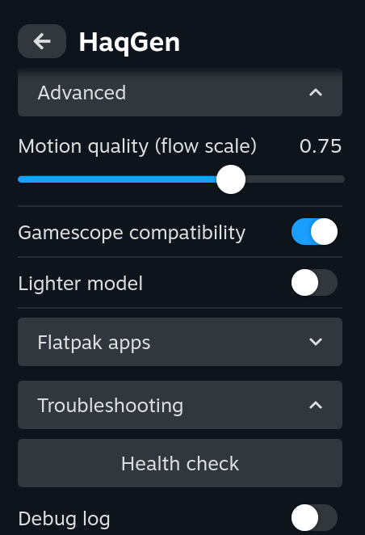

# HaqGen

Lossless Scaling frame generation for the Steam Deck, installed and managed from the Quick Access menu.

HaqGen is a [Decky Loader](https://decky.xyz) plugin built on [lsfg-vk](https://lsfg-vk.dev), the Linux implementation of Lossless Scaling's frame generation. It handles installation and configuration, provides a single launch option for all games, and offers simple controls while keeping the technical settings available.

 

**Status:** early release (v0.1), tested on a Steam Deck OLED. Bug reports and feedback are welcome in [Issues](https://github.com/Enotherms/HaqGen/issues).

## Features

- **Automated setup:** installs lsfg-vk 2.0 with checksum verification, locates the Lossless Scaling DLL and writes a valid configuration.
- **Single launch option:** `~/haqgen %command%` works for every game, with no per-game paths or profile names.
- **Profiles:** a Default profile for all games plus optional per-game profiles. The panel follows the game currently running.
- **Controls:** frame generation Off, 2x, 3x or 4x, and Battery, Balanced or Quality presets. Changes are saved automatically.
- **FPS cap:** limits the game's real frame rate before frame generation, giving steadier output than Steam's limiter.
- **Advanced settings:** flow scale, the lighter model and Gamescope compatibility, each with a short explanation.
- **Flatpak support:** enables frame generation for emulators and launchers installed from Discover.
- **Troubleshooting:** health check using lsfg-vk's validator, debug logging, a log viewer and configuration repair.
- **Clean removal:** lists every item before deletion and removes only what HaqGen created.
- **No background activity:** nothing runs during gameplay unless you interact with the panel.

## Quick start

1. Install [Decky Loader](https://decky.xyz).
2. Install [Lossless Scaling](https://store.steampowered.com/app/993090/Lossless_Scaling/) from Steam and switch it to the `lsfg-vk` beta branch: Library › Lossless Scaling › Properties › Betas › `lsfg-vk`.
3. Install HaqGen: Decky settings › Developer › **Install Plugin From URL**, using the link to `HaqGen-v*.zip` from the [latest release](https://github.com/Enotherms/HaqGen/releases).
4. Open HaqGen in the Quick Access menu and select **Set up**. Wait until all three checks pass.
5. Select **Copy launch option** and paste it into each game under Properties › **Launch Options**:

   ```
   ~/haqgen %command%
   ```

   If the field already contains text, keep `%command%` once, at the end.
6. Start the game and choose a multiplier in HaqGen.

## How it works

- **No game running:** the panel edits the Default profile, or the profile you select. **Create profile** adds a profile for an installed game, based on Default.
- **Game running:** the panel follows that game. **Save as profile for …** gives it dedicated settings; **Delete profile** (with confirmation) returns it to Default.
- **When changes apply:** multipliers and presets apply immediately. Turning frame generation off or on, the FPS cap and Gamescope compatibility apply the next time the game starts; the panel indicates when a restart is needed.

## Recommended settings

Keep Steam's frame limit off, or set it to the display refresh rate. Steam's limiter also counts generated frames and therefore reduces real ones. Use HaqGen's FPS cap instead, and disable the game's own upscaler or frame generation.

| Goal | FPS cap | Multiplier | Refresh rate | Result |
|---|---|---|---|---|
| Smoothness on the 90 Hz OLED | 30 | 3x | 90 Hz | 90 FPS |
| Cleaner motion | 45 | 2x | 90 Hz | 90 FPS, if the game sustains 45 |
| Demanding games | 30 | 2x | 60 Hz | 60 FPS with the lowest GPU cost |

2x produces cleaner motion than 3x. If GPU usage is close to 100%, use the Battery preset or lower the in-game settings. Steam's performance overlay may not count generated frames, so assess smoothness visually.

## Game support

| Game type | Frame generation | FPS cap |
|---|---|---|
| Windows games via Proton, DX12 | Supported | Supported (VKD3D-Proton) |
| Windows games via Proton, DX9–11 | Supported | Supported (DXVK) |
| Native Linux games (Vulkan) | Supported | Use the game's own limiter |
| 32-bit games | Usually supported; add `PROTON_USE_WOW64=1` if needed | Supported under Proton |
| Non-Steam games added to Steam | Supported (Default profile, or *Save as profile* while running) | Supported under Proton |
| Flatpak apps (emulators, launchers) | Supported via the Flatpak apps section | Not available |
| OpenGL-only games | Not supported; lsfg-vk requires Vulkan | Not supported |

## Requirements

- Steam Deck running SteamOS (developed on the OLED model)
- [Decky Loader](https://decky.xyz)
- [Lossless Scaling](https://store.steampowered.com/app/993090/Lossless_Scaling/) purchased on Steam, on the `lsfg-vk` beta branch. HaqGen never bundles or copies it.

<details>
<summary><b>Flatpak apps</b></summary>

Open **Flatpak apps** in the panel and enable an app. On first use, HaqGen installs lsfg-vk's official runtime extension `org.freedesktop.Platform.VulkanLayer.lsfgvk` (24.08 or 25.08, user-level, from Flathub), which may take a minute. It then grants the app read-only access to the lsfg-vk configuration and the Lossless Scaling folder, and sets `LSFGVK_CONFIG` and `LSFGVK_PROFILE`. Flatpak apps follow the Default profile, including Off and Gamescope compatibility. Existing Flatpak permissions are not modified. Set the emulator's graphics backend to Vulkan and restart the app after changing the setting.

</details>

<details>
<summary><b>Anti-cheat</b></summary>

HaqGen does not modify game files and does not read or write game memory. The only component loaded into a game is lsfg-vk's Vulkan layer, a graphics component comparable to the Steam overlay; the launcher only sets environment variables. HaqGen makes no attempt to hide from anti-cheat software. Some online games prohibit overlays or injected layers, so review the game's terms and test offline first. If a game reports a problem, set its profile to Off or remove the launch option.

</details>

<details>
<summary><b>Troubleshooting</b></summary>

- **Health check** (Troubleshooting) runs `lsfg-vk-cli validate` and `healthcheck` and displays the result.
- **No effect in game:** confirm the launch option is exactly `~/haqgen %command%`, Gamescope compatibility is on, and Lossless Scaling is on the `lsfg-vk` branch.
- **Invalid lsfg-vk configuration** (for example after another tool edited it): use **Reset lsfg-vk config**. A backup is kept.
- **More detail:** enable **Debug log**, restart the game, then open **Show log**. Disable it again for normal use.
- **Other Vulkan layers** that are always active (for example vkBasalt) can interfere. HaqGen warns when it detects them.

</details>

<details>
<summary><b>Removing HaqGen</b></summary>

Use **Danger zone › Remove plugin data**. It lists every item to be deleted and asks for confirmation. It removes HaqGen's files, its lsfg-vk installation, its profiles and its Flatpak changes, and never touches drivers, system files, games or Lossless Scaling. Steam launch options are not edited, so remove `~/haqgen %command%` from your games manually. Then uninstall HaqGen from Decky.

</details>

<details>
<summary><b>Development</b></summary>

The panel uses TypeScript and React (`@decky/ui`); the backend uses the Python standard library. The project is based on the official Decky plugin template and requires Node 26 LTS and pnpm 12.

```bash
pnpm install
pnpm build                # builds dist/index.js
pnpm test                 # frontend tests (vitest)
python3 -m pytest         # backend tests (Python 3.11+)
```

To install a development build, copy `dist/`, `main.py`, `plugin.json`, `package.json`, `LICENSE` and `py_modules/` into `~/homebrew/plugins/HaqGen` (owned by root) and restart Decky with `sudo systemctl restart plugin_loader`.

`scripts/deck-console.mjs` streams the Quick Access menu console. It requires Decky's *Allow Remote CEF Debugging* and an SSH tunnel: `ssh -N -L 9222:127.0.0.1:8080 deck@<deck-ip>`, then `node scripts/deck-console.mjs 127.0.0.1:9222`.

**Security:** disable development access when you are finished.

- *Allow Remote CEF Debugging* lets anything that can reach the debugger control Steam's interface, including your account and store. Turn it off in Decky settings › Developer and close the SSH tunnel.
- SSH with a password is reachable by every device on your network. When not developing, run `sudo systemctl disable --now sshd` on the Deck; otherwise use a strong password or SSH keys.
- Enable these only on trusted networks, never on public Wi-Fi.

</details>

## Credits

- [lsfg-vk](https://lsfg-vk.dev): the Vulkan layer that runs Lossless Scaling frame generation on Linux.
- [Lossless Scaling](https://store.steampowered.com/app/993090/Lossless_Scaling/): the frame generation technology.
- [Decky Loader](https://decky.xyz) and its plugin template.

HaqGen is an independent project by [Enotherms](https://github.com/Enotherms) and is not affiliated with Lossless Scaling, lsfg-vk or Decky Loader.

## License

[BSD 3-Clause](LICENSE)
