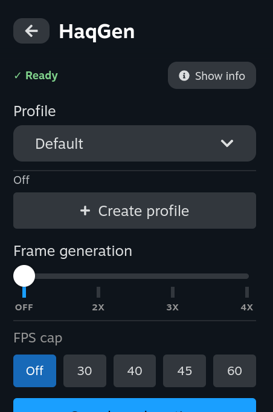

<p align="center">
  
</p>

<h1 align="center">HaqGen</h1>

<p align="center">
  <b>Lossless Scaling frame generation for the Steam Deck, set up and controlled from the Quick Access menu.</b>
</p>

<p align="center">
  <a href="https://github.com/Enotherms/HaqGen/releases"></a>
  <a href="LICENSE"></a>
  
  
</p>

<p align="center">
  
  &nbsp;
  
</p>

HaqGen is a [Decky Loader](https://decky.xyz) plugin built on [lsfg-vk](https://lsfg-vk.dev), the Linux version of Lossless Scaling's frame generation. It installs everything for you, gives you one launch option for all your games, and keeps the controls simple, while still exposing the technical settings when you want them.

> **Early release (v0.1).** Tested on a Steam Deck OLED. Feedback and bug reports are welcome in [Issues](https://github.com/Enotherms/HaqGen/issues).

## Highlights

| | |
|---|---|
| ⚡ **One-press setup** | Installs lsfg-vk 2.0 (checksum-verified), finds your Lossless Scaling DLL and writes a valid config. |
| 🎮 **One launch option** | Paste `~/haqgen %command%` into any game. No per-game paths or profile names to type. |
| 🗂️ **Profiles** | A Default profile for every game, plus per-game profiles. The panel follows the game you're playing. |
| 🎚️ **Simple controls** | Frame generation `Off · 2x · 3x · 4x`, presets `Battery · Balanced · Quality`, changes save automatically. |
| 🎯 **FPS cap** | Caps the game's real frame rate *before* frame generation, for steadier generated frames than Steam's limiter. |
| 🛠️ **Advanced** | Motion quality (flow scale), lighter model and Gamescope compatibility, with short notes behind *Show info*. |
| 📦 **Flatpak apps** | Turn frame generation on for emulators and launchers installed from Discover. |
| 🩺 **Troubleshooting** | Health check with lsfg-vk's own validator, debug log, log viewer and config repair. |
| 🧹 **Clean removal** | *Remove plugin data* shows exactly what it deletes and removes only what HaqGen created. |
| 🔋 **No background work** | Nothing runs while you play unless you press something. |

## Quick start

1. Install [Decky Loader](https://decky.xyz).
2. Install [Lossless Scaling](https://store.steampowered.com/app/993090/Lossless_Scaling/) from Steam and switch it to the **`lsfg-vk` beta branch**: Library › Lossless Scaling › Properties › Betas › `lsfg-vk`.
3. Install HaqGen: Decky settings › Developer › **Install Plugin From URL**, and paste the link to `HaqGen-v*.zip` from the [latest release](https://github.com/Enotherms/HaqGen/releases).
4. Open **HaqGen** in the Quick Access menu and press **Set up**. Wait for three ✓.
5. Press **Copy launch option** and paste it into each game: game › Properties › **Launch Options**.

   ```
   ~/haqgen %command%
   ```
   If the field already has text, keep `%command%` only once, at the end.
6. Start the game and pick a multiplier in HaqGen.

## How it works

- **No game running:** the panel edits the *Default* profile, or the profile you pick. **Create profile** makes one for an installed game, starting from Default.
- **Game running:** the panel follows that game. **Save as profile for …** gives it its own settings; **Delete profile** (asks first) sends it back to Default.
- **What applies when:** 2x/3x/4x and presets apply instantly. Switching frame generation Off or on, the FPS cap and Gamescope compatibility apply the next time the game starts. The panel reminds you.

## Recommended settings

Leave **Steam's frame limit off** (or at your screen's refresh rate). Steam's limiter counts generated frames too, so it cuts real ones. Cap the game with HaqGen's **FPS cap** instead, and turn off the game's own upscaler or frame generation.

| Goal | FPS cap | Multiplier | Screen | Result |
|---|---|---|---|---|
| Smooth on the 90 Hz OLED | 30 | 3x | 90 Hz | 90 FPS |
| Cleaner motion | 45 | 2x | 90 Hz | 90 FPS (if the game can hold 45) |
| Heavy games | 30 | 2x | 60 Hz | 60 FPS, least GPU cost |

2x looks cleaner than 3x. If the GPU is near 100%, use the *Battery* preset or lower in-game settings. Steam's performance overlay may not count generated frames, so judge smoothness by eye.

## Game support

| Game type | Frame generation | FPS cap |
|---|---|---|
| Windows games via Proton, DX12 | ✅ | ✅ VKD3D-Proton |
| Windows games via Proton, DX9–11 | ✅ | ✅ DXVK |
| Native Linux games (Vulkan) | ✅ | ➖ use the game's limiter |
| 32-bit games | ✅ usually (add `PROTON_USE_WOW64=1` if needed) | ✅ under Proton |
| Non-Steam games added to Steam | ✅ (Default profile, or *Save as profile* while running) | ✅ under Proton |
| Flatpak apps (emulators, launchers) | ✅ via the *Flatpak apps* section | ➖ |
| OpenGL-only games | ❌ lsfg-vk needs Vulkan | ❌ |

## Requirements

- Steam Deck with SteamOS (developed on the OLED model)
- [Decky Loader](https://decky.xyz)
- [Lossless Scaling](https://store.steampowered.com/app/993090/Lossless_Scaling/) bought on Steam, on the `lsfg-vk` beta branch. HaqGen never includes or copies it.

<details>
<summary><b>Flatpak apps</b></summary>

Open **Flatpak apps** in the panel and switch an app on. The first time, HaqGen installs lsfg-vk's official runtime extension `org.freedesktop.Platform.VulkanLayer.lsfgvk` (24.08 or 25.08, user-level, from Flathub), which can take a minute. It then gives the app read-only access to lsfg-vk's config and to the Lossless Scaling folder, and sets `LSFGVK_CONFIG` and `LSFGVK_PROFILE` for it. Flatpak apps follow the Default profile, including Off and Gamescope compatibility. Your own Flatpak permissions are never changed. Set the emulator's graphics backend to Vulkan and restart the app after switching.

</details>

<details>
<summary><b>Anti-cheat</b></summary>

HaqGen never changes game files and never reads or writes game memory. The only thing loaded into a game is lsfg-vk's Vulkan layer, a graphics component similar to the Steam overlay; the launcher only sets environment variables. HaqGen does not try to hide from anti-cheat. Some online games forbid overlays or injected layers, so check the game's rules and try it offline first. If a game complains, set its profile to Off or remove the launch option.

</details>

<details>
<summary><b>Troubleshooting</b></summary>

- **Run Health check** (Troubleshooting). It runs `lsfg-vk-cli validate` and `healthcheck` and shows the result.
- **Frame generation does nothing:** check that the launch option is exactly `~/haqgen %command%`, Gamescope compatibility is on, and Lossless Scaling is on the `lsfg-vk` branch.
- **lsfg-vk reports a broken config** (for example after another tool edited it): use **Reset lsfg-vk config**. It keeps a backup.
- **Need details:** turn on **Debug log**, restart the game, then use **Show log**. Turn it off again for daily play.
- **Other Vulkan layers** that are always on (for example vkBasalt) can interfere. HaqGen warns you about them.

</details>

<details>
<summary><b>Removing HaqGen</b></summary>

Use **Danger zone › Remove plugin data**. It lists exactly what will be deleted and asks first. It removes HaqGen's files, its lsfg-vk install, its profiles and its Flatpak changes, and never touches drivers, system files, your games or Lossless Scaling. Launch options in Steam are not edited, so remove `~/haqgen %command%` from your games yourself. Then uninstall HaqGen from Decky.

</details>

<details>
<summary><b>Development</b></summary>

Stack: TypeScript and React (`@decky/ui`) for the panel, the Python standard library for the backend, built from the official Decky plugin template. Requires Node 26 LTS and pnpm 12.

```bash
pnpm install
pnpm build                # builds dist/index.js
pnpm test                 # frontend tests (vitest)
python3 -m pytest         # backend tests (Python 3.11+)
```

To install a development build, copy `dist/`, `main.py`, `plugin.json`, `package.json`, `LICENSE` and `py_modules/` into `~/homebrew/plugins/HaqGen` (owned by root) and restart Decky with `sudo systemctl restart plugin_loader`.

`scripts/deck-console.mjs` streams the Quick Access menu's console. It needs Decky's *Allow Remote CEF Debugging* and an SSH tunnel: `ssh -N -L 9222:127.0.0.1:8080 deck@<deck-ip>`, then `node scripts/deck-console.mjs 127.0.0.1:9222`.

> **Security: switch development access off when you are done.**
> - *Allow Remote CEF Debugging* lets anything that can reach the debugger control Steam's interface, including your account and store. Turn it off in Decky settings › Developer when you finish, and close the SSH tunnel.
> - SSH with a password is reachable by every device on your network. When you are not developing, run `sudo systemctl disable --now sshd` on the Deck; if you keep it on, use a strong password or SSH keys.
> - Only enable these on networks you trust, never on public Wi-Fi.

</details>

## Credits

- [lsfg-vk](https://lsfg-vk.dev): the Vulkan layer that runs Lossless Scaling frame generation on Linux.
- [Lossless Scaling](https://store.steampowered.com/app/993090/Lossless_Scaling/): the frame generation itself.
- [Decky Loader](https://decky.xyz) and its plugin template.

HaqGen is an independent project by [Enotherms](https://github.com/Enotherms) and is not affiliated with Lossless Scaling, lsfg-vk or Decky Loader.

## License

[BSD 3-Clause](LICENSE).
